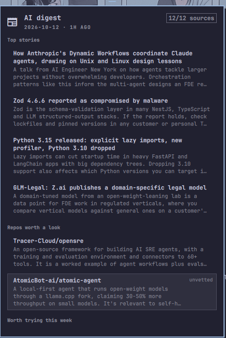

# AI Digest 󰎕

A bar widget for Omarchy that is the reading surface for the `ai-digest`
systemd service: today's AI stories, a few repos worth a look, and one thing
to try, in a keyboard panel.




The service does all the work — fetching feeds, calling Claude, validating the
result. This plugin only reads the files it writes and keeps one file of its
own (what you've read). No polling, no processes per keystroke, no AI calls
from the shell.

## The icon

| Looks like | Means |
|---|---|
| dot | the newest digest isn't marked done |
| pulsing | the service is running |
| urgent colour | the last run degraded (most feeds down), failed, or has been running for 30+ minutes |

A degraded day that is also unread shows both. Stale feeds (answering, but
quiet for longer than usual) don't change the icon; they're listed in the panel.

## Keys

| Key | Action |
|---|---|
| `j` / `k`, ↓ / ↑ | move |
| `Tab` / `Shift-Tab`, `1`-`4` | next / previous section, jump to Top / Repos / Try / Skipped |
| `Enter`, `o` | open the link (marks the item read) |
| `c` | copy the link |
| `a` | ask your default agent about the item |
| `e` | open the day's markdown in your editor |
| `r` | run the digest now |
| `m` | mark the day's digest done (clears the dot) |
| `Esc` | close |

Bind a key to summon it on the focused monitor, e.g. in
`~/.config/hypr/bindings.lua`:

```lua
o.bind("SUPER + ALT + D", "AI digest", "omarchy-shell shell toggle io.github.ki11e6.ai-digest")
```

## Files

| Path | Written by | Used for |
|---|---|---|
| `~/.local/state/ai-digest/status.json` | service, last | run state; the only service file the panel watches |
| `~/ai-digest/index.json` | service | which day is newest |
| `~/ai-digest/YYYY-MM-DD.json` | service | the day shown |
| `~/ai-digest/YYYY-MM-DD.md` | service | `e`, and days without JSON (shown as plain text) |
| `~/.local/state/ai-digest/reader.json` | this plugin | read items and done days |

The bar runs one copy of the widget per monitor. Each copy watches
`reader.json` and merges changes from the others, so marking a day done on one
monitor clears the dot on all of them.

## Requirements

- Omarchy 4 with the shell plugin framework
- The `ai-digest` service (structured JSON output, `status.json` and `index.json`)

## Development

```bash
node test/digest-test.js   # pure logic in Digest.js
./dev.sh                   # copy into ~/.config/omarchy/plugins, validate, restart the shell, enable
```

## License

MIT
